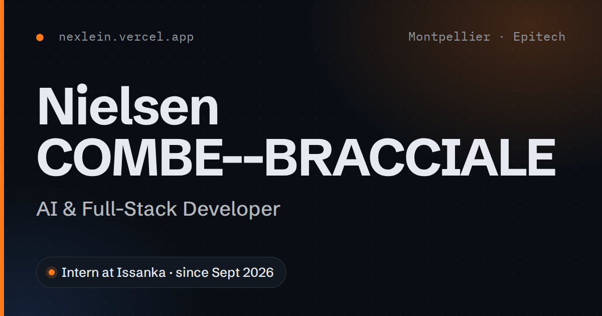

# Portfolio

[](https://github.com/Nexlein/Portfolio/actions/workflows/ci.yml)

Portfolio of Nielsen COMBE--BRACCIALE (Nexlein), AI & full-stack developer. Vanilla TypeScript and Vite, every page prerendered in English and French, with the map, charts and CV computed from the data.

**[nexlein.vercel.app](https://nexlein.vercel.app)** · [Français](https://nexlein.vercel.app/fr/) · [CV (PDF)](https://nexlein.vercel.app/cv.pdf)



| What     | How                                                                                           |
| -------- | --------------------------------------------------------------------------------------------- |
| Pages    | home, one page per project, CV, 404; each in English and in French under `/fr/`               |
| Build    | vanilla TypeScript and Vite, no framework; every page rendered at build time from `src/data/` |
| Hosting  | Vercel: production from `main`, a preview per PR                                              |
| Checks   | Git hooks, `npm run check`, browser tests, Lighthouse, CV PDF; required on `main`             |
| Versions | Node and tools: [`mise.toml`](mise.toml). Packages: [`package.json`](package.json)            |

## Quick start

Needs Git and [mise](https://mise.jdx.dev).

```bash
mise install                      # Node and the hook tools, at the versions in mise.toml
npm ci                            # dependencies, and the Git hooks
npx playwright install chromium   # for test:e2e, cv:pdf and media:brand
npm run dev                       # http://localhost:5173
```

On Windows, add `%LOCALAPPDATA%\mise\shims` to your user `Path` so the hooks find mise's tools ([troubleshooting](docs/troubleshooting.md)).

Only for some tasks:

| Tool                                     | For                                         |
| ---------------------------------------- | ------------------------------------------- |
| ffmpeg                                   | `npm run media`, `npm run media:video`      |
| bash with GNU `mktemp`                   | `npm run media:video` (Git Bash on Windows) |
| [uv](https://docs.astral.sh/uv/) (`uvx`) | redrawing the QR codes                      |
| Brave                                    | the VS Code F5 browser config               |

## Commands

| Command                         | Does                                                                                                 |
| ------------------------------- | ---------------------------------------------------------------------------------------------------- |
| `npm run dev`                   | dev server, port 5173                                                                                |
| `npm run build`                 | typecheck, then build to `dist/`                                                                     |
| `npm run preview`               | serve `dist/` with the production headers, port 4173                                                 |
| `npm run check`                 | every CI check that needs no build: audit, format, lint, dead code, typecheck, workflows, unit tests |
| `npm test`                      | unit tests (Vitest)                                                                                  |
| `npm run test:e2e`              | build, then browser tests (Playwright)                                                               |
| `npm run typecheck`             | `tsc` on the site, then on scripts and configs                                                       |
| `npm run lint`                  | Oxlint and Stylelint; `lint:fix` fixes what it can                                                   |
| `npm run format`                | Prettier on tracked files; `format:check` only reports                                               |
| `npm run knip`                  | dead code and unused dependencies                                                                    |
| `npm run audit`                 | fail on high or critical advisories                                                                  |
| `npm run cv:pdf`                | print the CV to `cv-pdf/`, after a build; fails past one A4 page                                     |
| `npm run codemap`               | refresh `.claude/codemap.md` (the pre-commit hook does it)                                           |
| `npm run media`                 | missing posters, card copies and project social images                                               |
| `npm run media:brand`           | redraw the home social images and the icons                                                          |
| `npm run media:video -- <file>` | re-encode one video for the web, in place                                                            |

## Docs

| Page                                               | Read it to                                                   |
| -------------------------------------------------- | ------------------------------------------------------------ |
| [docs/architecture.md](docs/architecture.md)       | see how a page is built, languages, head tags, CSP           |
| [docs/content.md](docs/content.md)                 | change text, add a project, prepare media                    |
| [docs/checks.md](docs/checks.md)                   | know what each hook, test and CI job checks                  |
| [docs/operations.md](docs/operations.md)           | release, GitHub and Vercel settings, scheduled jobs, updates |
| [docs/repo-map.md](docs/repo-map.md)               | find where something is configured                           |
| [docs/troubleshooting.md](docs/troubleshooting.md) | fix a known problem                                          |
| [docs/adr/](docs/adr/README.md)                    | learn why things are the way they are                        |
| [CLAUDE.md](CLAUDE.md)                             | rules for AI agents                                          |
| [SECURITY.md](SECURITY.md)                         | report a vulnerability                                       |

## License

All rights reserved. The code is public to read ([ADR 0012](docs/adr/0012-no-open-source-licence.md)).
