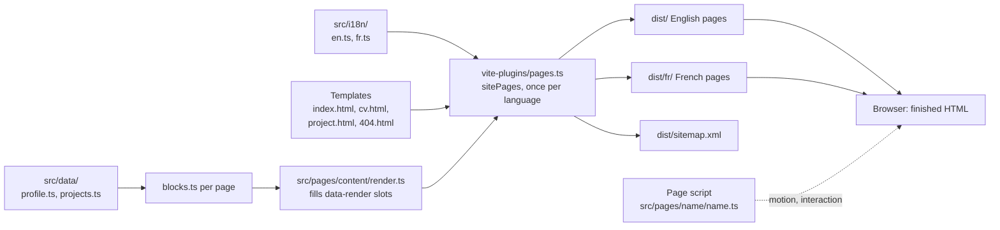
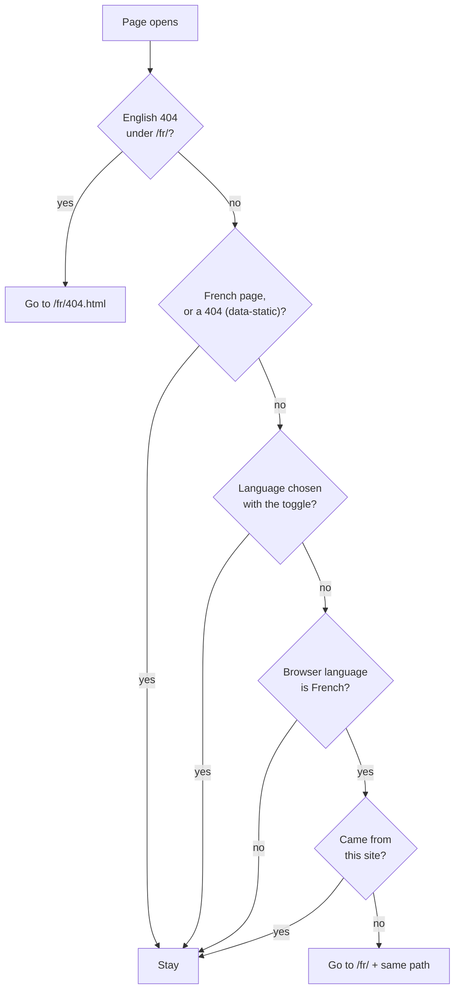

# Architecture

How a page gets from the data to the visitor, and the rules that keep it fast, bilingual and safe.

## Build and data flow

Every page is rendered at build time, once per language ([ADR 0006](adr/0006-build-time-rendering-per-language.md)). Visitors and crawlers get finished HTML; page scripts only add motion and interaction.



| Step                                          | Where                                               |
| --------------------------------------------- | --------------------------------------------------- |
| Facts, `{ en, fr }`                           | `src/data/` ([content.md](content.md))              |
| Interface words                               | `src/i18n/{en,fr}.ts`                               |
| Slots in templates                            | `data-render="<block>"`, `data-i18n="<key>"`        |
| Block registry                                | `BLOCKS` in `src/pages/content/render.ts`           |
| Page list, head tags, sitemap                 | `PAGES` and `renderPage` in `vite-plugins/pages.ts` |
| Tags every page shares (favicon, head script) | `vite-plugins/shared-head.ts`                       |
| Dev server                                    | same plugin, renders `/fr/*` on the fly             |

## Pages

| Page    | Template       | Script                           | English               | French                   |
| ------- | -------------- | -------------------------------- | --------------------- | ------------------------ |
| Home    | `index.html`   | `src/pages/home/home.ts`         | `/`                   | `/fr/`                   |
| CV      | `cv.html`      | `src/pages/cv/cv.ts`             | `/cv.html`            | `/fr/cv.html`            |
| Project | `project.html` | `src/pages/project/project.ts`   | `/projects/<id>.html` | `/fr/projects/<id>.html` |
| 404     | `404.html`     | `src/pages/notfound/notfound.ts` | any unknown URL       | `/fr/404.html`           |

- One project page per entry in `src/data/projects.ts`. `project.html` itself is not published.
- The 404 is not in the sitemap and is `noindex`. Vercel serves the one English `404.html`; under `/fr/` the head script moves on to `/fr/404.html`.

Redirects (`vercel.json`):

| From                                                  | To                            | Kind      |
| ----------------------------------------------------- | ----------------------------- | --------- |
| `/cv.pdf`, `/fr/cv.pdf`                               | the `cv` GitHub release files | temporary |
| `/availability.html`, `/fr/availability.html`         | `/#contact`, `/fr/#contact`   | permanent |
| `/projects/{myradar,mytop,secured}.html` (and `/fr/`) | `/#work`, `/fr/#work`         | permanent |

## Languages

- The URL decides the language: English at the root, French under `/fr/`.
- The EN/FR toggle opens the same page in the other language and stores the choice.
- Each language gets its own `<html lang>`, title, description, Open Graph tags, canonical URL and `hreflang` alternates.

The head script (`HEAD_SCRIPT` in `vite-plugins/shared-head.ts`) runs before first paint:



The same script applies the stored theme (else Daylight for a light system preference, else Midnight) and adds `html.js`.

Runtime strings: scripts that write text at runtime (toasts, button labels) call `i18n.t('<key>')` (`src/core/i18n.ts`). The build embeds only the `home.*` keys (`clientStrings` in `src/core/translate.ts`), and only on pages with `strings: true` in `PAGES` (the home page today). `src/i18n/dictionaries.test.ts` checks every key a script asks for: write it as a literal, or add it to the test's list of built keys.

## Head tags and SEO

`renderPage` (`vite-plugins/pages.ts`) writes every SEO tag; templates keep only what is not SEO.

| Tag                   | Source                                                                                              |
| --------------------- | --------------------------------------------------------------------------------------------------- |
| Title, description    | `meta.<page>.*` in `src/i18n/{en,fr}.ts`; projects: their data                                      |
| Canonical, `hreflang` | the page path, per language                                                                         |
| Open Graph, X image   | `public/og-image.png` / `og-image-fr.png` (home, CV, 404); `public/projects/<id>/og.jpg` (projects) |
| JSON-LD               | `src/core/structured-data.ts`                                                                       |
| Sitemap               | `PAGES` (the 404 is left out); `public/robots.txt` points to it                                     |

Site URL and owner: `src/core/site.ts`.

## Folders

```
src/
├── components/   one folder per UI feature (Charts, Footer, Hero, Nav, NeuralMap); internals stay inside
├── core/         site facts, translation, dates, structured data, analytics
├── data/         the content: profile.ts, projects.ts, skills.ts
├── i18n/         interface text: en.ts, fr.ts
├── pages/        per page: blocks, entry script, styles; content/render.ts maps blocks
├── styles/       tokens.css (tokens, themes), base.css (shared pieces)
└── ui/           shared helpers: icons, videos, motion, reveals
public/           served as is: icons, social images, QR codes, project media
vite-plugins/     build-time rendering (pages.ts) and shared head tags (shared-head.ts)
```

Every file, with what it exports and who uses it: `.claude/codemap.md` (generated). Configs and workflows: [repo-map.md](repo-map.md).

Imports:

- Across folders: the `@/` alias (`@/core/i18n`). Within a folder: `./`.
- Modules the build runs from Node (blocks, `render.ts`, data, Charts data and render, NeuralMap graph, Nav and Footer render) use relative `.ts` imports only. `src/pages/node-safe.test.ts` follows the imports from `vite-plugins/pages.ts` and `vite-plugins/shared-head.ts` and fails on anything else.
- HTML templates stay at the repo root, so their URLs do not change.

## Security headers and CSP

Strict Content-Security-Policy: own origin only, no `unsafe-inline` ([ADR 0005](adr/0005-strict-csp.md)). Headers live in `vercel.json`; `vite preview` serves the same ones (`vite.config.ts`), so CSP problems show up locally and in browser tests.

Rules for HTML and scripts:

- No inline `style="…"`, inline `<script>` or inline event handlers in templates (`src/pages/headers.test.ts`). Set styles from JS through the CSSOM.
- The one inline script is the head script, allowed by its sha256 hash.
- Content stays readable without JavaScript: reveals hide only under `html.js`. Respect `prefers-reduced-motion`.

| Header or rule              | Vercel (production) | `npm run preview` (port 4173)       | WebKit e2e server (port 4174, CI)                     |
| --------------------------- | ------------------- | ----------------------------------- | ----------------------------------------------------- |
| CSP and security headers    | `vercel.json`       | same                                | same                                                  |
| `upgrade-insecure-requests` | yes                 | removed (breaks `http://localhost`) | removed                                               |
| Cross-Origin-Opener-Policy  | yes                 | yes                                 | removed (`PREVIEW_WITHOUT_COOP`, WebKit stalls on it) |
| Cache-Control rules         | `vercel.json`       | none                                | none                                                  |

## Runtime details

- Fonts: Schibsted Grotesk (variable) and IBM Plex Mono, self-hosted with Fontsource, so pages make no third-party requests ([ADR 0004](adr/0004-no-third-party-requests.md)).
- Videos: `preload="none"`, played only on screen (IntersectionObserver in `src/ui/video.ts`), paused off screen. A video the visitor paused stays paused. Under `prefers-reduced-motion` they never autoplay.
- Analytics: Vercel Web Analytics, cookie-free, loaded only in builds made on Vercel (`IS_VERCEL_BUILD` in `vite.config.ts`, script in `src/core/analytics.ts`).
- Themes: sets of custom properties on `html[data-theme]` in `src/styles/tokens.css`; the list is in `src/components/Nav/themes.ts`.

## Recipes

### Add a page

| Step                                                                                                | File                                                                 |
| --------------------------------------------------------------------------------------------------- | -------------------------------------------------------------------- |
| 1. Template with `data-render` / `data-i18n` slots, no inline code (start from a copy of `cv.html`) | `<name>.html` at the root                                            |
| 2. Build input                                                                                      | `build.rolldownOptions.input` in `vite.config.ts`                    |
| 3. Entry script and styles                                                                          | `src/pages/<name>/<name>.ts`, `<name>.css`                           |
| 4. Blocks, registered in `BLOCKS` (import them with a relative `.ts` path, like `home` and `cv`)    | `src/pages/<name>/blocks.ts`, `src/pages/content/render.ts`          |
| 5. Page entry: `fixedPage(path, template, key, jsonLd?, strings?)`                                  | `PAGES` in `vite-plugins/pages.ts`                                   |
| 6. Title, and a description of 51 to 160 characters                                                 | `meta.<key>.*` in `src/i18n/{en,fr}.ts`                              |
| 7. Browser tests and Lighthouse                                                                     | page list in `e2e/pages.spec.ts`, URLs in `config/lighthouserc.json` |

`src/pages/pages.test.ts` and `src/pages/content/render.test.ts` then check the tags, the sitemap and the blocks. A page whose script needs runtime strings outside `home.*` also needs `clientStrings` changed. A link to it in the top nav goes in `src/components/Nav/render.ts`.

### Add a third-party origin

1. Add the origin to the matching directive in the CSP in `vercel.json`.
2. Loosen the lock in `src/pages/headers.test.ts` ("locks every fetch to our own origin").
3. Allow it in `e2e/pages.spec.ts` ("no request leaves our own origin").

### Change the head script

1. Edit `HEAD_SCRIPT` in `vite-plugins/shared-head.ts`.
2. Run `npm test`: `src/pages/headers.test.ts` fails and prints the new hash on the `- Expected` line.
3. Put the hash in `script-src` in `vercel.json`. `src/pages/head-script.test.ts` covers the behaviour.

### Add a theme

1. Its `[data-theme='<id>']` block in `src/styles/tokens.css`, with the same custom properties as the others.
2. Its id in `src/components/Nav/themes.ts`.
3. Its name under `site.themes` in both dictionaries.

The menu swatch is drawn from the token block.

`src/components/Nav/themes.test.ts` checks the block, its properties, the id and both names.
