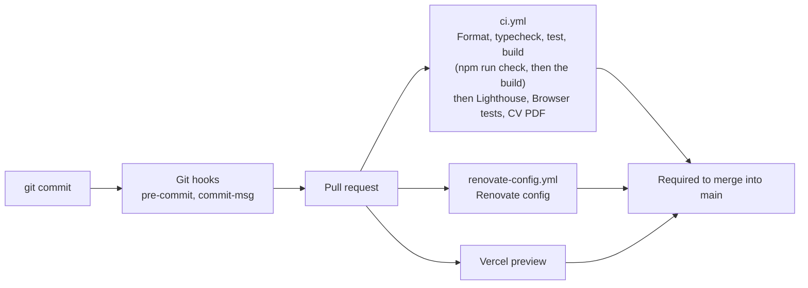

# Checks

What runs where, from a commit to a release. One list of checks for local and CI: `npm run check` ([ADR 0014](adr/0014-npm-run-check.md)).

## Local

| Step                   | Runs                                                                                                                                    |
| ---------------------- | --------------------------------------------------------------------------------------------------------------------------------------- |
| `.husky/pre-commit`    | `.husky/no-secrets.sh` → `npx lint-staged` → `npm run typecheck` → `npm run test` → `npm run codemap` (and stages `.claude/codemap.md`) |
| `.husky/no-secrets.sh` | blocks `.env` files; gitleaks on staged changes, or a short regex list if gitleaks is missing                                           |
| `.lintstagedrc`        | staged TS/JS: Oxlint fix + Prettier; CSS: Stylelint fix + Prettier; workflows: `.husky/actionlint.sh`; others: Prettier                 |
| `.husky/actionlint.sh` | actionlint (and shellcheck on `run:` scripts) on staged workflows; skipped with a note if missing                                       |
| `.husky/commit-msg`    | first line must be a Conventional Commit                                                                                                |

Commit message rule (`.husky/commit-msg`, local only, CI does not check it):

- `type(scope)!: subject`, with type one of `feat fix docs style refactor perf test build ci chore revert`.
- Scope is optional, characters `a-z 0-9 . _ -`.
- `Merge …`, `Revert "…"`, `fixup! …` and `squash! …` pass as they are.

Tools the hooks need (gitleaks, actionlint, shellcheck) come from `mise.toml` (`mise install`). Hooks are installed by `npm ci` (the `prepare` script). Never pass `--no-verify`.

`npm run check` runs the `check` script in `package.json`, and stops at the first failure.

It needs the network (`npm audit`). Two checks see tracked files only, so stage a new file first: `format:check` (`scripts/format.ts`) and the docs test (a file a doc names must be tracked).

## CI

| Workflow                                | When                                      | Jobs (`name:`)                                                                                        |
| --------------------------------------- | ----------------------------------------- | ----------------------------------------------------------------------------------------------------- |
| `.github/workflows/ci.yml`              | every PR, every push to `main`            | Format, typecheck, test, build → Lighthouse, Browser tests, CV PDF → Publish CV (push to `main` only) |
| `.github/workflows/renovate-config.yml` | every PR                                  | Renovate config (validates `renovate.json` only when the PR changes it)                               |
| `.github/workflows/uptime.yml`          | scheduled, by hand                        | Production answers ([operations.md](operations.md#scheduled-jobs))                                    |
| `.github/workflows/rebuild.yml`         | scheduled, by hand                        | Rebuild production                                                                                    |
| CodeQL (GitHub default setup)           | PRs into `main`, pushes to `main`, weekly | analysis; not a required check; PRs into `dev` get none                                               |
| Dependabot security updates (GitHub)    | on an advisory                            | PRs into `main` ([operations.md](operations.md#dependency-updates))                                   |

Composite actions: `.github/actions/setup` (Node from `mise.toml`, npm cache, `npm ci`) and `.github/actions/browsers` (Playwright browsers and their system packages).

> [!WARNING]
> Required checks on `main` match job `name:` strings. Renaming a job in `ci.yml` or `renovate-config.yml` blocks every PR into `main` until the branch rule is updated. This is also why no workflow uses `paths-ignore` and the Renovate config job runs on every PR: a required check must always report.

## Unit tests

Vitest, colocated as `src/**/*.test.ts`. DOM tests start with `// @vitest-environment happy-dom`. A new test file needs a row here: `src/docs.test.ts` fails otherwise.

| Test                                                                                          | Checks                                                                                                                                                                                                              |
| --------------------------------------------------------------------------------------------- | ------------------------------------------------------------------------------------------------------------------------------------------------------------------------------------------------------------------- |
| `src/docs.test.ts`                                                                            | docs: relative links and anchors, tracked repo paths, `npm run` scripts, indexes, and a row in this table for every test file                                                                                       |
| `src/i18n/dictionaries.test.ts`                                                               | EN and FR have the same keys and `{slots}`; every key a page or script asks for exists                                                                                                                              |
| `src/data/profile.test.ts`                                                                    | profile text in every language, no styling or classes, unique ids, ordered dates                                                                                                                                    |
| `src/data/projects.test.ts`                                                                   | unique ids, exactly 3 featured, school-year dates, real past months, one spelling per skill, media exist (WebP/MP4, posters, card copies), descriptions and alt texts in both languages, GitHub links, domain names |
| `src/data/skills.test.ts`                                                                     | tags to skills: `C/C++`, `RL`, `CI/CD`, case                                                                                                                                                                        |
| `src/pages/pages.test.ts`                                                                     | every page in every language: lang, filled text, head tags, 1200×630 image, canonical, `hreflang`, JSON-LD, sitemap                                                                                                 |
| `src/pages/headers.test.ts`                                                                   | CSP: head script by hash only, no `unsafe-*`, own origin; no inline code in the HTML templates; redirects                                                                                                           |
| `src/pages/head-script.test.ts`                                                               | theme, blocked storage, first French visit; same script as injected                                                                                                                                                 |
| `src/pages/node-safe.test.ts`                                                                 | Node-run modules import only `node:*`, `vite`, `happy-dom` or relative `.ts` files                                                                                                                                  |
| `src/pages/seo.test.ts`                                                                       | `robots.txt` and the default social image                                                                                                                                                                           |
| `src/pages/content/render.test.ts`                                                            | every `data-render` block exists and is used; CV renders per language                                                                                                                                               |
| `src/pages/project/render.test.ts`                                                            | shared skills between projects                                                                                                                                                                                      |
| `src/core/translate.test.ts`                                                                  | an unknown key stops the build; `data-i18n` filling                                                                                                                                                                 |
| `src/core/i18n.test.ts`                                                                       | runtime strings read from the page                                                                                                                                                                                  |
| `src/core/analytics.test.ts`                                                                  | analytics only on Vercel builds, same origin, once                                                                                                                                                                  |
| `src/core/structured-data.test.ts`                                                            | JSON-LD blocks                                                                                                                                                                                                      |
| `src/core/text.test.ts`, `src/core/time.test.ts`                                              | text helpers; month maths in UTC                                                                                                                                                                                    |
| `src/components/Nav/themes.test.ts`                                                           | every theme has a token block and a name in both languages                                                                                                                                                          |
| `src/components/NeuralMap/graph.test.ts`                                                      | map similarity; cards never overlap, up to 40 projects, every width                                                                                                                                                 |
| `src/components/NeuralMap/scene.test.ts`                                                      | map geometry helpers                                                                                                                                                                                                |
| `src/components/Charts/data.test.ts`                                                          | chart counts from the data                                                                                                                                                                                          |
| `src/components/Hero/sims/neural.test.ts`, `src/components/Hero/sims/value-iteration.test.ts` | hero simulations                                                                                                                                                                                                    |
| `src/ui/video.test.ts`, `src/ui/video.dom.test.ts`                                            | video helpers; play on screen only, reduced motion, manual pause                                                                                                                                                    |
| `src/ui/boot.test.ts`, `src/ui/glide.test.ts`                                                 | page boot keeps going after an error; easing curve                                                                                                                                                                  |

## Browser tests

Browser tests (also called e2e): Playwright (`e2e/`, `playwright.config.ts`) against the production build, served by `vite preview` with the production headers.

| Where | Engines                           | Server                                            |
| ----- | --------------------------------- | ------------------------------------------------- |
| Local | desktop and mobile Chromium       | port 4173, reused if already running              |
| CI    | the same, plus Firefox and WebKit | 4173; WebKit on 4174 without COOP, videos stubbed |

- `npm run test:e2e` builds, then runs them. Firefox and WebKit run in CI only ([ADR 0010](adr/0010-test-policy.md)).
- `retries: 0`: a test that needs a second try is a bug.
- The shared fixture (`e2e/fixtures.ts`) fails a test on any console error, uncaught exception or CSP violation. Tests that open their own browser context are not covered.

| Spec                      | Covers                                                                                             |
| ------------------------- | -------------------------------------------------------------------------------------------------- |
| `e2e/pages.spec.ts`       | every page: headers, fonts, no errors, no request off the origin, CV PDF links, no sideways scroll |
| `e2e/home.spec.ts`        | content without JS, copy email, reduced motion, keyboard, print                                    |
| `e2e/home-hero.spec.ts`   | hero simulations, pause, hidden tab, resize                                                        |
| `e2e/home-map.spec.ts`    | project map (desktop), phone list                                                                  |
| `e2e/home-charts.spec.ts` | path chart ranges, tooltips, numbers cards                                                         |
| `e2e/home-nav.spec.ts`    | themes, language switch, first French visit                                                        |
| `e2e/project.spec.ts`     | project page: video, gallery, connected projects, back link                                        |
| `e2e/not-found.spec.ts`   | English and French 404                                                                             |

## Lighthouse and CV PDF

- Lighthouse (CI job after the build): the pages and minimum scores are in `config/lighthouserc.json`. Every assertion is an error, performance included ([ADR 0010](adr/0010-test-policy.md)). Reports are uploaded as a workflow artifact.
- CV PDF: `npm run cv:pdf` (after a build) prints `/cv.html` and `/fr/cv.html` to A4 into `cv-pdf/` and fails if either needs a second page ([ADR 0007](adr/0007-cv-pdf-release.md)).

## Linting and dead code

| Tool      | Config                                   | Checks                                                                                   |
| --------- | ---------------------------------------- | ---------------------------------------------------------------------------------------- |
| Oxlint    | `.oxlintrc.json`                         | TypeScript, type-aware, warnings fail ([ADR 0003](adr/0003-oxlint-instead-of-eslint.md)) |
| Stylelint | `.stylelintrc.json`                      | CSS                                                                                      |
| Prettier  | `.prettierrc`                            | every tracked file, except `.prettierignore`                                             |
| knip      | `config/knip.json`                       | unused files, exports and dependencies                                                   |
| tsc       | `tsconfig.json`, `tsconfig.scripts.json` | site; scripts and configs                                                                |
