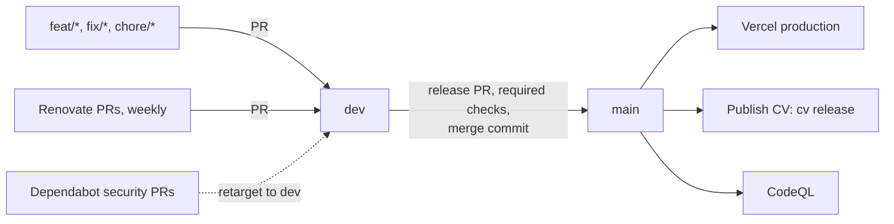

# Operations

Branches, releases, settings that live on GitHub and Vercel, scheduled jobs and dependency updates.

## Branches and release

`main` is production. `dev` is the integration branch ([ADR 0009](adr/0009-dev-main-flow.md)).

| Branch                       | From  | Merges into         | Notes                                       |
| ---------------------------- | ----- | ------------------- | ------------------------------------------- |
| `feat/*`, `fix/*`, `chore/*` | `dev` | `dev` (PR)          | Vercel builds a preview for each PR         |
| `dev`                        |       | `main` (release PR) | not protected; CI runs through its PRs only |
| `main`                       |       |                     | protected, deploys production               |

Release:

1. Open a PR from `dev` into `main` ("Release: ...").
2. Wait for every required check (see [GitHub settings](#github-settings)).
3. Merge with a merge commit. Squash and rebase are off: a squash would make `dev` and `main` diverge.
4. Vercel's Git integration deploys production from `main`. The push also runs CI again, and its `Publish CV` job uploads the PDFs.
5. Check production: run the uptime workflow by hand (Actions → Uptime check → Run workflow).

`main` holds the release merge commits, which `dev` does not (`git log dev..main`). They carry no change of their own: no back-merge is needed.

Hotfix: branch `fix/*` from `main`, PR into `main`, then merge `main` into `dev`. Every required check runs, Lighthouse included, for admins too (`enforce_admins`).

Rollback of a bad deploy:

1. Vercel's [Instant Rollback](https://vercel.com/docs/instant-rollback) puts the previous production build back at once, with no check. On the Hobby plan it goes back one deployment only.
2. Vercel then stops sending new pushes to the production domain. Fix the bug with a hotfix.
3. Promote the fixed deployment (dashboard, or `vercel promote <deployment>`): production follows `main` again.

Tags to keep (protected by a ruleset): `cv` (the CV release), `v1-classic` (the old site), `prototype-redesign` (design prototypes).

## GitHub settings

| Setting                             | Value                                                                                                                                                          | Where (Settings →) |
| ----------------------------------- | -------------------------------------------------------------------------------------------------------------------------------------------------------------- | ------------------ |
| `main` branch protection            | required checks: Format, typecheck, test, build · Lighthouse · Browser tests · CV PDF · Renovate config · Vercel. Admins included. No force push, no deletion. | Branches           |
| Merge button                        | merge commits only                                                                                                                                             | General            |
| Tag ruleset "Release tags stay put" | the tags to keep ([list](#branches-and-release)): no deletion, no update                                                                                       | Rules → Rulesets   |
| Actions                             | actions must be pinned to a full commit SHA (an unpinned `uses:` fails); default token read-only                                                               | Actions → General  |
| Code security                       | CodeQL default setup, Dependabot security updates, secret scanning with push protection, private vulnerability reporting                                       | Advanced Security  |
| Social preview                      | `public/og-image.png`                                                                                                                                          | General            |
| About                               | description = README intro = `package.json` description (one sentence in three places, kept by hand); website = `SITE`                                         | repo home page, ⚙  |

Required check names are job `name:` strings: see the warning in [checks.md](checks.md#ci).

## Vercel

| What               | How                                                                                                                                                                                              |
| ------------------ | ------------------------------------------------------------------------------------------------------------------------------------------------------------------------------------------------ |
| Production         | every push to `main`                                                                                                                                                                             |
| Previews           | every PR; behind Vercel login                                                                                                                                                                    |
| Project settings   | framework preset, build command and output directory (`dist/`) are dashboard values (Project → Settings → Build and Deployment), not in the repo: `vercel.json` holds only headers and redirects |
| Node version       | `engines.node` in `package.json`, which overrides the project setting ([Vercel docs](https://vercel.com/docs/functions/runtimes/node-js/node-js-versions))                                       |
| Headers, redirects | `vercel.json` ([architecture.md](architecture.md#security-headers-and-csp))                                                                                                                      |
| Analytics          | Vercel Web Analytics, turned on in the dashboard (Project → Analytics). Cookie-free, so no consent banner.                                                                                       |
| Deploy Hook        | one for `main` (Project → Settings → Git → Deploy Hooks); its URL is the repo secret `VERCEL_DEPLOY_HOOK`                                                                                        |

## CV release

`/cv.pdf` and `/fr/cv.pdf` redirect (`vercel.json`) to the files of the GitHub release `cv` ([ADR 0007](adr/0007-cv-pdf-release.md)).

- `CV PDF` renders the PDFs on every PR and push; `Publish CV` uploads them on pushes to `main` only, with `--clobber`.
- GitHub lists it as the repository's Latest release. That is harmless: the redirects name the tag, not "latest". (`--latest=false` in `ci.yml` applies only if CI has to create the release again.) The tag never moves (ruleset).

## Scheduled jobs

| Workflow                        | Schedule (UTC)          | Does                                                                                                     |
| ------------------------------- | ----------------------- | -------------------------------------------------------------------------------------------------------- |
| `.github/workflows/uptime.yml`  | see its `cron`          | checks production: home and project page `zappy` (EN, FR), sitemap, both 404s, both CV links reach a PDF |
| `.github/workflows/rebuild.yml` | see its `cron` (weekly) | calls the Vercel Deploy Hook, so dates computed at build time ("past 12 months") stay current            |
| CodeQL                          | weekly                  | code scanning                                                                                            |

- A failed scheduled run fails the workflow, and GitHub emails the owner.
- Scheduled runs start late or get dropped under load ([GitHub docs](https://docs.github.com/en/actions/reference/workflows-and-actions/events-that-trigger-workflows)): expect hours of delay, not minutes.
- GitHub turns scheduled workflows off after 60 days without repository activity. After a quiet spell, check the Actions tab.
- `rebuild.yml` fails on purpose when `VERCEL_DEPLOY_HOOK` is missing.

## Dependency updates

| Source                      | Opens                                                                                                                                                                                                                                                             | Into                                              |
| --------------------------- | ----------------------------------------------------------------------------------------------------------------------------------------------------------------------------------------------------------------------------------------------------------------- | ------------------------------------------------- |
| Renovate (`renovate.json`)  | weekly: npm minor and patch (one PR), GitHub Actions (one PR), lockfile refresh (one PR); npm majors one PR each, Actions majors one grouped PR ([`separateMajorMinor`](https://docs.renovatebot.com/configuration-options/#separatemajorminor) wins over groups) | `dev`                                             |
| Dependabot security updates | a PR per advisory Renovate cannot fix (transitive)                                                                                                                                                                                                                | `main`: retarget with `gh pr edit <n> --base dev` |

Renovate ([ADR 0013](adr/0013-renovate-instead-of-dependabot.md)):

- Reads `renovate.json` from `main` only. A change to it takes effect after the next release.
- One invalid rule stops it entirely. The `Renovate config` job runs on every PR (so `main` can require it) and validates the file when the PR changes it.
- npm releases wait 3 days before a PR (`security:minimumReleaseAgeNpm`).
- A Node major moves `mise.toml`, `engines` and `@types/node` in one PR, once the release line is LTS.
- Status and pending updates: the Dependency Dashboard issue ([#137](https://github.com/Nexlein/Portfolio/issues/137)).

## Recipes

### Bump the Node major

Renovate opens it as one PR. By hand:

1. `node` in `mise.toml`.
2. `engines.node` and `@types/node` in `package.json`.
3. `npm install`, and commit the refreshed `package-lock.json` (`npm ci` refuses a stale one).
4. Check that Vercel offers that major ([Vercel docs](https://vercel.com/docs/functions/runtimes/node-js/node-js-versions)).

### Move to a custom domain

| File or place                                         | Change                                                                                     |
| ----------------------------------------------------- | ------------------------------------------------------------------------------------------ |
| `src/core/site.ts`                                    | `SITE`                                                                                     |
| `public/robots.txt`                                   | sitemap URL                                                                                |
| `.github/workflows/uptime.yml`                        | `SITE`                                                                                     |
| `.github/workflows/ci.yml`                            | the `cv` release notes (stable links)                                                      |
| `scripts/brand-images.ts`, then `npm run media:brand` | URL on the social images                                                                   |
| `public/qrcode.svg`, `public/qrcode-fr.svg`           | redo ([content.md](content.md#media))                                                      |
| `src/core/structured-data.test.ts`                    | expected URLs                                                                              |
| Vercel (Project → Settings → Domains)                 | add the domain; redirect `nexlein.vercel.app` to it                                        |
| `README.md`, `CLAUDE.md`                              | live links                                                                                 |
| GitHub About                                          | website                                                                                    |
| The `cv` release notes                                | `gh release edit cv --notes ...`: `ci.yml` sets them only when it creates the release      |
| Google Search Console                                 | new property; `public/googlebdd9a71b4a94f2b4.html` stays byte for byte (`.prettierignore`) |
